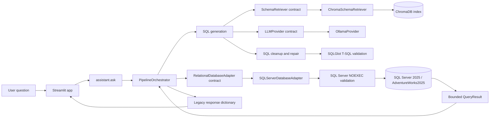

# SSA — SQL Server AI Assistant

SSA is a local RAG-powered assistant that translates natural-language questions into validated, read-only SQL Server T-SQL queries. The current workflow targets SQL Server 2025 and the AdventureWorks2025 sample database, using Ollama with Qwen2.5-Coder for local SQL generation and ChromaDB for schema retrieval.

SSA is an engineering project, not a general accuracy guarantee or a substitute for database permissions, query review, or production governance.

Repository: [github.com/fabioeaffreitas/ssa-sql-server-assistant](https://github.com/fabioeaffreitas/ssa-sql-server-assistant)

Current development version: `0.1.0`. SSA is not a production-ready `1.0.0` release. The SQL Server MVP `1.0.0` milestone is planned after the CP34 release validation checkpoint. SSA follows a simple Semantic Versioning convention: `0.x.y` denotes development and stabilization releases, `1.0.0` denotes the validated SQL Server MVP, and later versions represent incremental features or compatibility updates. Install dependencies from `requirements.txt`; the project metadata file does not currently define a supported `pip install .` packaging workflow.

## Current capabilities

- Natural-language SQL generation with Ollama and the configured local model.
- ChromaDB-backed schema retrieval with hybrid semantic and keyword ranking, including current domain-specific ranking boosts.
- SQL Server/T-SQL prompt construction grounded in retrieved schema context.
- SQL cleanup, Markdown fence removal, and repair of misplaced terminal `TOP N` clauses.
- SQLGlot T-SQL parsing with single-statement, SELECT-only, and `SELECT INTO` restrictions.
- SQL Server schema compilation using `NOEXEC` before query execution.
- Bounded SQL Server execution with configurable connection/query timeouts and a 100-row default result limit.
- Truncation detection and structured result conversion for Streamlit and evaluation scripts.
- Ollama token-usage reporting with model, prompt-token, completion-token, and total-token fields.
- Provider-neutral pipeline diagnostics for retrieval, generation, validation, execution, and total timings, plus failure-stage reporting.
- Streamlit interface for generated SQL, validation state, diagnostics, usage tracking, and bounded results.

The implemented database workflow is SQL Server-specific. PostgreSQL, MySQL, MongoDB, and other NoSQL platforms are not currently supported.

## Architecture

The active request path is:



The provider-neutral internal contracts are defined in `ssa/contracts.py`:

- `LLMProvider` describes relational query generation.
- `SchemaRetriever` describes question-based schema retrieval.
- `RelationalDatabaseAdapter` separates validation and bounded read execution.
- `GenerationRequest`, `GenerationResult`, `UsageMetadata`, `QueryResult`, and `PipelineDiagnostics` carry typed internal data.

The active implementations are Ollama, ChromaDB, and SQL Server. The contracts are internal seams; they do not imply that all database platforms share the same query or execution semantics.

The active ChromaDB path is implemented by `ChromaSchemaRetriever` and delegates to the hybrid retrieval logic in `ssa/schema_retrieval.py`. `ssa/schema_search.py` is a separate semantic-search utility and is not used by the active assistant pipeline.

Deterministic test implementations are available in `tests/fakes.py`, including fake LLM providers, schema retrievers, SQL generators, and relational database adapters.

## Technology stack

| Technology | Role |
| --- | --- |
| Python 3.12 | Application and test runtime |
| Streamlit | Local web interface |
| Ollama | Local LLM runtime |
| Qwen2.5-Coder 7B | Current SQL-generation model |
| ChromaDB | Persistent schema retrieval index |
| SQLGlot | T-SQL parsing and SELECT-only validation |
| pyodbc | SQL Server connectivity |
| ODBC Driver 18 for SQL Server | Current SQL Server driver |
| SQL Server 2025 | Current database platform |
| AdventureWorks2025 | Development and evaluation database |
| pytest | Deterministic and integration tests |

## Installation

SSA requires Python 3.12, SQL Server 2025 with AdventureWorks2025, Microsoft ODBC Driver 18 for SQL Server, and a local Ollama installation with the configured model available. The ODBC driver, SQL Server, and Ollama are external prerequisites and are not installed by this repository.

From PowerShell:

```powershell
git clone https://github.com/fabioeaffreitas/ssa-sql-server-assistant.git
cd ssa-sql-server-assistant
python -m venv .venv
.\.venv\Scripts\Activate.ps1
python -m pip install -r requirements.txt
```

Copy `.env.example` to `.env` and edit the values for the local environment. Use `SQL_SERVER` for a host, named instance, or host-and-port value supported by the ODBC connection string, and install Microsoft ODBC Driver 18 separately. Do not commit `.env`, credentials, or generated `data/` and `reports/` artifacts.

Install or start Ollama separately, then make the configured model available. The current default model is `qwen2.5-coder:7b`.

## Configuration

Configuration is loaded from environment variables, including a local `.env` file when present. The supported names and defaults are:

| Variable | Purpose | Default |
| --- | --- | --- |
| `SQL_SERVER` | SQL Server host or instance | `localhost` |
| `SQL_DATABASE` | Database name | `AdventureWorks2025` |
| `SQL_DRIVER` | ODBC driver name | `ODBC Driver 18 for SQL Server` |
| `SQL_TRUSTED_CONNECTION` | Windows authentication toggle; use `no` for SQL authentication | `yes` |
| `SQL_USERNAME` | SQL authentication username | Required when trusted connection is disabled |
| `SQL_PASSWORD` | SQL authentication password | Required when trusted connection is disabled |
| `SQL_ENCRYPT` | Whether the ODBC connection encrypts traffic | `yes` |
| `SQL_TRUST_SERVER_CERTIFICATE` | Whether to skip normal certificate-chain validation | `yes` |
| `SQL_CONNECTION_TIMEOUT` | SQL Server connection timeout in seconds | `10` |
| `SQL_QUERY_TIMEOUT` | SQL query timeout in seconds | `30` |
| `OLLAMA_BASE_URL` | Ollama service URL | `http://localhost:11434` |
| `OLLAMA_MODEL` | Model name passed to Ollama | `qwen2.5-coder:7b` |
| `OLLAMA_REQUEST_TIMEOUT` | Ollama request timeout in seconds | `300` |

Boolean settings accept `yes`, `no`, `true`, `false`, `1`, or `0`. Timeout settings must be positive integers.

For Windows authentication, leave `SQL_TRUSTED_CONNECTION=yes`; the current connection uses the Windows identity running SSA. For SQL authentication, set `SQL_TRUSTED_CONNECTION=no` and provide non-empty `SQL_USERNAME` and `SQL_PASSWORD` through the local environment. Never place real credentials in documentation or source control.

`SQL_ENCRYPT` controls whether the ODBC connection encrypts traffic. `SQL_TRUST_SERVER_CERTIFICATE` controls certificate validation; it does not disable encryption. The local example uses `SQL_ENCRYPT=yes` and `SQL_TRUST_SERVER_CERTIFICATE=yes` to accommodate common self-signed development certificates. Trusting the server certificate bypasses normal certificate-chain validation, so production deployments should use `SQL_TRUST_SERVER_CERTIFICATE=no` with a certificate that the client can validate.

## Preparing the schema index

The schema workflow exports metadata from SQL Server, creates readable schema context, and builds the persistent ChromaDB index. Run these commands from the repository root:

```powershell
.\.venv\Scripts\python.exe -m ssa.schema_export
.\.venv\Scripts\python.exe -m ssa.schema_context
.\.venv\Scripts\python.exe -m ssa.schema_index
```

The default ChromaDB persistence path is `data/chroma_db` and the active collection is `ssa_schema`; these are currently fixed in the application rather than environment-configurable. The export step requires a working SQL Server connection. Generated metadata, context, and ChromaDB files are local artifacts and are not source-controlled application code.

## Running SSA

Start the Streamlit application with:

```powershell
.\.venv\Scripts\python.exe -m streamlit run app.py
```

The interface asks questions about AdventureWorks2025, displays generated SQL, reports validation and execution status, shows diagnostics, and renders bounded results.

## Diagnostics and usage

Successful and failed assistant responses include a `diagnostics` object with this structure:

```python
{
    "timings_ms": {
        "retrieval_ms":  ...,
        "generation_ms": ...,
        "validation_ms": ...,
        "execution_ms":  ...,
        "total_ms":      ...,
    },
    "failure_stage": None,  # or generation/validation/connection/execution/configuration
}
```

Generation responses may also contain:

```python
{
    "usage": {
        "model": "qwen2.5-coder:7b",
        "prompt_tokens": 0,
        "completion_tokens": 0,
        "total_tokens": 0,
    }
}
```

Missing token counts use zero at the public compatibility boundary. Reported totals are calculated from prompt plus completion tokens.

## Security and operational boundaries

Current safeguards include:

- SQLGlot T-SQL parsing.
- Exactly one SQL statement per generated query.
- SELECT-only restrictions.
- Rejection of `SELECT INTO`.
- SQL Server schema compilation with `NOEXEC` before execution.
- Separate validation and execution connections in the SQL Server workflow.
- Connection and query timeouts.
- A default maximum of 100 returned rows with one-extra-row truncation detection.
- Cursor and connection cleanup with rollback handling.
- Sanitized user-facing error messages for provider and driver failures.

SSA does not enforce a database account's permissions. Configure the SQL Server connection with a least-privilege account appropriate for the intended read-only scope. SQL validation is not a substitute for database permissions, query review, or production governance.

The current local example enables `SQL_TRUST_SERVER_CERTIFICATE=yes`; production deployments should review certificate handling. The application also prints questions, generated SQL, and result rows to the console, so deployment environments should handle logs appropriately. No production multi-tenant isolation, audit system, or external telemetry is provided.

## Testing and evaluation

Run the deterministic suite with:

```powershell
.\.venv\Scripts\python.exe -m pytest -q -m "not integration"
```

These tests use deterministic fakes for LLM providers, schema retrievers, SQL generators, and database adapters. They do not require Ollama, ChromaDB, SQL Server, or pyodbc connections.

At CP27 completion, the deterministic suite passed 154 tests; this count is a milestone and may increase as coverage grows.

Run integration tests separately when the local services and database are configured:

```powershell
.\.venv\Scripts\python.exe -m pytest -m integration
```

The live evaluation script runs the fixed 14-question AdventureWorks2025 evaluation set and writes a timestamped CSV under `reports/`:

```powershell
.\.venv\Scripts\python.exe -m scripts.run_live_sql_eval
```

The verified result is **14/14 successful end-to-end evaluations** on that fixed AdventureWorks2025 set. This is a project-specific evaluation result, not a general accuracy guarantee.

## Continuous integration

GitHub Actions runs the deterministic test suite on `windows-latest` with Python 3.12. The workflow installs `requirements-dev.txt`, runs `python -m pip check`, and executes pytest with an isolated runner temporary directory:

```powershell
python -m pytest -q -m "not integration"
```

CI does not install or start SQL Server, Ollama, ChromaDB services, AdventureWorks2025, or the Microsoft ODBC driver. Integration tests and the live evaluation are therefore excluded from CI; run them separately in an environment configured with the required local services and database. CI verifies reproducible Python installation and deterministic behavior, not live database connectivity or model-generation quality.

## Project status and roadmap

### Implemented

- SQL Server 2025 and AdventureWorks2025 workflow.
- Local Ollama generation with Qwen2.5-Coder.
- ChromaDB schema retrieval and hybrid ranking.
- SQL Server/T-SQL prompt construction, SQL cleanup, and repair.
- SQLGlot SELECT-only validation and SQL Server NOEXEC schema validation.
- Bounded SQL Server execution with timeout, cancellation, cleanup, and truncation handling.
- Streamlit interface and legacy response compatibility.
- CP21.6 provider-neutral pipeline timings and failure-stage diagnostics.
- CP22–CP27 provider-neutral contracts, adapters, orchestration, injectable SQL-generation seams, reusable fakes, and deterministic end-to-end regression tests.

### Planned

- Additional LLM providers: OpenAI, Anthropic Claude, and Google Gemini.
- Relational adapters for PostgreSQL and MySQL.
- Exploratory MongoDB and other NoSQL integrations with separate execution semantics.
- Broader cross-provider and cross-database integration coverage.

The planned integrations are architectural goals only. They are not implemented or supported by the current application.

## Contributing

Before opening a pull request:

1. Keep credentials, `.env`, `data/`, and `reports/` out of commits.
2. Preserve SELECT-only validation, timeout handling, cleanup, and the 100-row limit.
3. Add deterministic tests for behavior changes.
4. Run the deterministic suite and describe any required external services.
5. Keep provider- and database-specific behavior isolated so future integrations remain possible.

Please open an issue first for larger architectural changes or new provider/database integrations.
