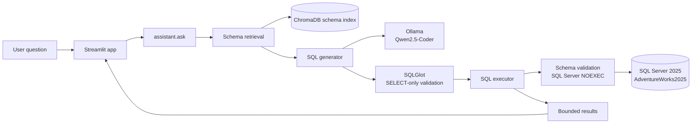

# SSA — SQL Server AI Assistant

SSA is an open-source, local AI assistant that turns natural-language questions into validated, read-only SQL queries. The current implementation targets SQL Server 2025 and the AdventureWorks2025 database, using Ollama and Qwen2.5-Coder for local SQL generation.

The project explores a practical architecture for schema-aware Text-to-SQL: retrieve relevant database metadata, ground generation with that context, validate the generated query, and execute it through a bounded read-only workflow.

Repository: [github.com/fabioeaffreitas/ssa-sql-server-assistant](https://github.com/fabioeaffreitas/ssa-sql-server-assistant)

## Why SSA?

Traditional database tools require users to know table names, column names, joins, and SQL syntax. SSA provides a natural-language interface while keeping the database boundary explicit:

- schema context is retrieved before generation;
- generated SQL is checked before execution;
- only single-statement `SELECT` queries are accepted;
- database access is bounded by connection/query timeouts and a 100-row result limit;
- local inference keeps the current development workflow on the user's machine.

SSA is an engineering project and not a replacement for database permissions, query review, or production governance.

## Current capabilities

- Natural-language-to-T-SQL generation.
- Schema-aware retrieval using ChromaDB and RAG context.
- Local Ollama integration with Qwen2.5-Coder.
- SQLGlot-based SELECT-only and single-statement validation.
- SQL Server schema compilation before execution.
- SQL Server connection and query timeout handling.
- Result retrieval capped at 100 rows, with truncation detection.
- Safe configuration validation and user-facing error classification.
- Streamlit user interface with token-usage tracking.
- Provider-neutral pipeline observability reports retrieval, generation, validation, execution, and total timings, together with the failure stage for unsuccessful requests.

## Architecture



The active retrieval path is implemented in `ssa/schema_retrieval.py`. `ssa/schema_search.py` is a separate semantic-search utility and is not part of the active assistant path.

## Technology stack

| Technology | Role |
| --- | --- |
| Python 3.12 | Application and test runtime |
| Streamlit | Local web interface |
| Ollama | Local LLM runtime |
| Qwen2.5-Coder 7B | Current SQL-generation model |
| ChromaDB | Persistent schema retrieval index |
| SQLGlot | SQL parsing and SELECT-only validation |
| pyodbc | SQL Server connectivity |
| ODBC Driver 18 for SQL Server | Current SQL Server driver |
| SQL Server 2025 | Current database platform |
| AdventureWorks2025 | Development and evaluation database |
| pytest | Deterministic and integration tests |

## Installation

SSA currently requires Python 3.12, SQL Server 2025 with AdventureWorks2025, ODBC Driver 18 for SQL Server, and a locally installed Ollama runtime with the configured model available. Those external services and drivers are not installed by this repository.

From PowerShell:

```powershell
git clone https://github.com/fabioeaffreitas/ssa-sql-server-assistant.git
cd ssa-sql-server-assistant
python -m venv .venv
.\.venv\Scripts\Activate.ps1
python -m pip install -r requirements.txt
```

Copy `.env.example` to `.env`, then edit the values for the local environment. Do not commit `.env` or credentials.

## Configuration

The repository provides `.env.example` with local-development defaults. Configuration names supported by the current code include:

| Variable | Purpose | Default |
| --- | --- | --- |
| `SQL_SERVER` | SQL Server host or instance | `localhost` |
| `SQL_DATABASE` | Database name | `AdventureWorks2025` |
| `SQL_DRIVER` | ODBC driver name | `ODBC Driver 18 for SQL Server` |
| `SQL_TRUSTED_CONNECTION` | Windows authentication toggle | `yes` |
| `SQL_USERNAME` | SQL authentication username | Required when trusted connection is disabled |
| `SQL_PASSWORD` | SQL authentication password | Required when trusted connection is disabled |
| `SQL_ENCRYPT` | ODBC encryption toggle | `yes` |
| `SQL_TRUST_SERVER_CERTIFICATE` | Whether to trust the server certificate | `yes` in the current local default |
| `SQL_CONNECTION_TIMEOUT` | Connection timeout in seconds | `10` |
| `SQL_QUERY_TIMEOUT` | SQL query timeout in seconds | `30` |
| `OLLAMA_BASE_URL` | Local LLM service URL | `http://localhost:11434` |
| `OLLAMA_MODEL` | Model name passed to Ollama | `qwen2.5-coder:7b` |
| `OLLAMA_REQUEST_TIMEOUT` | LLM request timeout in seconds | `300` |

Boolean settings accept `yes`, `no`, `true`, `false`, `1`, or `0`. Timeout settings must be positive integers.

For SQL authentication, set `SQL_TRUSTED_CONNECTION=no` and provide `SQL_USERNAME` and `SQL_PASSWORD` through the local environment. Never place real credentials in documentation, source control, or issue reports.

## Preparing the schema index

The current schema workflow targets SQL Server and writes generated artifacts under `data/`:

```powershell
python -m ssa.schema_export
python -m ssa.schema_context
python -m ssa.schema_index
```

The export step requires a working SQL Server connection. The generated metadata, context, and ChromaDB files are local artifacts and are not part of the source-controlled application.

## Running SSA

Start the Streamlit application with:

```powershell
streamlit run app.py
```

The main application asks questions about AdventureWorks2025, displays generated SQL, reports validation status, and renders bounded results.

## Testing and evaluation

The default deterministic suite does not require SQL Server or Ollama:

```powershell
.\.venv\Scripts\python.exe -m pytest -q -m "not integration"
```

Integration tests require the configured external services:

```powershell
.\.venv\Scripts\python.exe -m pytest -m integration
```

The live evaluation script runs the current 14-question AdventureWorks2025 evaluation set and writes a timestamped CSV under `reports/`:

```powershell
.\.venv\Scripts\python.exe -m scripts.run_live_sql_eval
```

The verified project result is **14/14 successful end-to-end evaluations** on the current AdventureWorks2025 evaluation set. This is a project-specific evaluation result, not a general accuracy guarantee.

## Security and operational boundaries

Current protections include:

- SELECT-only, single-statement SQL validation before execution.
- SQL Server schema compilation before the query is run.
- Connection and query timeouts.
- A maximum of 100 returned rows.
- Configuration validation for connection settings and timeout values.
- Sanitized user-facing errors that avoid exposing passwords, connection strings, or raw driver details.
- Local Ollama inference in the current implementation.

These protections have limitations:

- SQL validation is not a substitute for least-privilege database permissions.
- The database account should be restricted to the intended read-only scope.
- `SQL_TRUST_SERVER_CERTIFICATE=yes` is convenient for the current local setup but should be reviewed for production use.
- Generated SQL should still be reviewed for important or sensitive workloads.
- The current application prints diagnostic information such as questions, generated SQL, and result rows to the console during execution; deployment environments should handle logs appropriately.
- No production multi-tenant isolation, audit system, or external telemetry is provided.

## Roadmap

### Implemented

- SQL Server and AdventureWorks2025 support.
- Ollama-based local generation.
- ChromaDB schema retrieval and RAG grounding.
- SELECT-only validation and bounded execution.
- Streamlit interface and deterministic test coverage.
- CP21.6 provider-neutral pipeline observability, including stage timings and failure-stage diagnostics.

### Planned

- Provider abstraction for additional LLM integrations:
  - OpenAI
  - Anthropic Claude
  - Google Gemini
- Database adapters for PostgreSQL and MySQL.
- Exploratory support for MongoDB and other NoSQL systems.
- More formal provider and database capability interfaces.
- Broader integration and regression coverage across providers and database platforms.

The planned integrations are architectural goals only; they are not implemented in the current repository.

## Contributing

Contributions are welcome. Before opening a pull request:

1. Keep credentials, `.env`, `data/`, and `reports/` out of commits.
2. Preserve the SELECT-only safety policy, timeout handling, and 100-row limit.
3. Add deterministic tests for behavior changes.
4. Run the default test suite and describe any required external services.
5. Keep provider- and database-specific behavior isolated so future integrations remain possible.

Please open an issue first for larger architectural changes or new provider/database integrations.

## Project status

SSA is an active engineering and learning project. The current implementation is deliberately focused on a local SQL Server workflow while keeping the boundaries clear for future provider and database extensibility.
